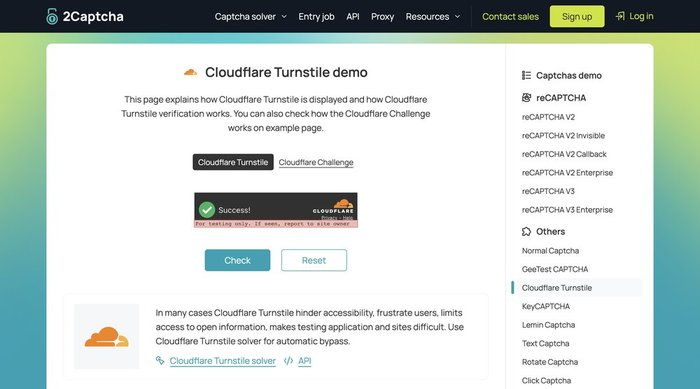
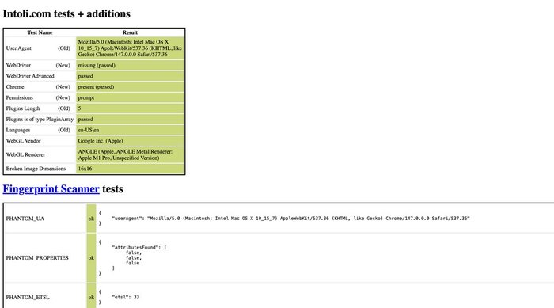
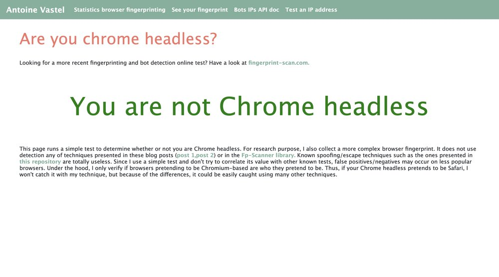
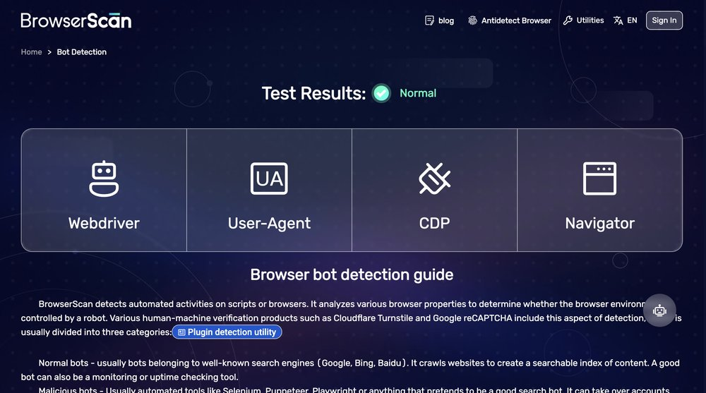
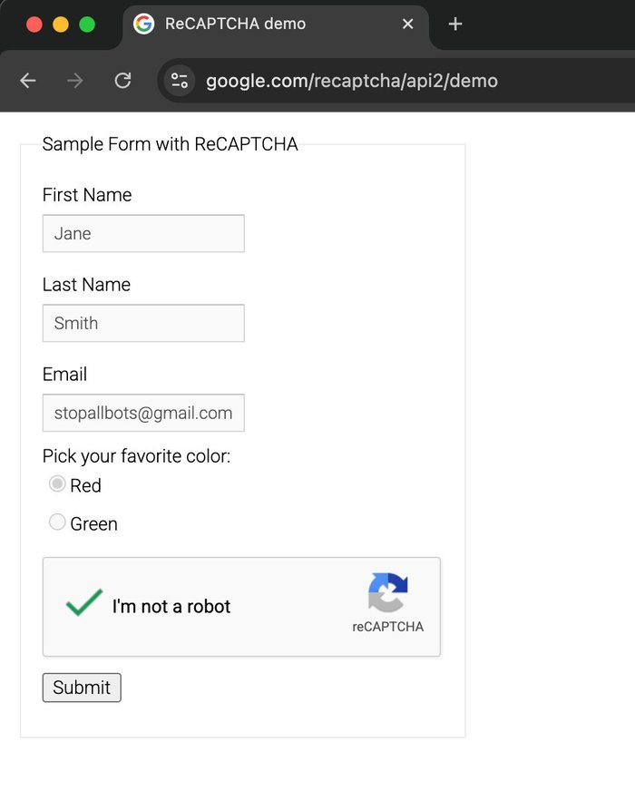

<div align="center">


# MCP Stealth Chrome

An MCP server with 173 tools that gives an AI agent a real Chrome browser and an HTTP client with Chrome's TLS fingerprint.

[](https://pypi.org/project/mcp-stealth-chrome/)
[](https://opensource.org/licenses/MIT)
[](https://www.python.org)

</div>

It drives Chrome over CDP with [nodriver](https://github.com/ultrafunkamsterdam/nodriver), so there is no WebDriver and the identity stays that of your real browser and machine. Requests that need no browser go through [curl_cffi](https://github.com/lexiforest/curl_cffi), which is much lighter than rendering a page. Search and page reading work without an API key.

Use the browser when a page needs JavaScript, a login or a person looking at it. Use HTTP when you only need the data.

- ✅ Real Chrome over CDP, with no WebDriver
- ✅ HTTP with the TLS fingerprint of Chrome, Firefox or Safari
- ✅ Search and page reading without an API key
- ✅ Real mouse input, and results that say what actually happened
- ✅ Passwords and cookies hidden from tool output by default
- ✅ Several browsers side by side, each with its own profile
- ✅ Works with Claude Code, Cursor, Codex, Gemini CLI, OpenCode, Droid and other MCP clients

## Install

You need [uv](https://docs.astral.sh/uv/) and Chrome or Chromium. uv takes care of Python 3.11+.

| OS | uv | Chrome |
|----|----|--------|
| macOS | `curl -LsSf https://astral.sh/uv/install.sh \| sh` | `brew install --cask google-chrome` |
| Ubuntu or Debian | `curl -LsSf https://astral.sh/uv/install.sh \| sh` | `sudo apt install -y google-chrome-stable` |
| Windows | `powershell -c "irm https://astral.sh/uv/install.ps1 \| iex"` | `winget install Google.Chrome` |

Then add the server to your client. Open the one you use:

<details>
<summary><b>Claude Code</b></summary>

All projects:

```bash
claude mcp add stealth-chrome --scope user -- uvx mcp-stealth-chrome@latest
```

Current project only:

```bash
claude mcp add stealth-chrome -- uvx mcp-stealth-chrome@latest
```
</details>

<details>
<summary><b>Claude Desktop</b></summary>

Edit the config file, then restart the app:

- macOS: `~/Library/Application Support/Claude/claude_desktop_config.json`
- Windows: `%APPDATA%\Claude\claude_desktop_config.json`
- Linux: `~/.config/Claude/claude_desktop_config.json`

```json
{
  "mcpServers": {
    "stealth-chrome": {
      "command": "uvx",
      "args": ["mcp-stealth-chrome@latest"]
    }
  }
}
```
</details>

<details>
<summary><b>Cursor</b></summary>

Use `~/.cursor/mcp.json` for all projects, or `.cursor/mcp.json` in one project:

```json
{
  "mcpServers": {
    "stealth-chrome": {
      "command": "uvx",
      "args": ["mcp-stealth-chrome@latest"]
    }
  }
}
```
</details>

<details>
<summary><b>Windsurf</b></summary>

Use `~/.windsurf/mcp.json` for all projects, or `.windsurf/mcp.json` in one project:

```json
{
  "servers": {
    "stealth-chrome": {
      "command": "uvx",
      "args": ["mcp-stealth-chrome@latest"]
    }
  }
}
```
</details>

<details>
<summary><b>VS Code (Continue, Cline, Kilo Code)</b></summary>

Use your VS Code settings or `~/.continue/config.json` for all projects, or `.vscode/mcp.json` in one project:

```json
{
  "mcpServers": {
    "stealth-chrome": {
      "command": "uvx",
      "args": ["mcp-stealth-chrome@latest"]
    }
  }
}
```
</details>

<details>
<summary><b>Zed</b></summary>

Open Settings, then Extensions, then MCP Servers, or edit `~/.config/zed/settings.json`:

```json
{
  "context_servers": {
    "stealth-chrome": {
      "command": {
        "path": "uvx",
        "args": ["mcp-stealth-chrome@latest"]
      }
    }
  }
}
```
</details>

<details>
<summary><b>Codex CLI</b></summary>

Add to `~/.codex/config.toml`:

```toml
[mcp_servers.stealth-chrome]
command = "uvx"
args = ["mcp-stealth-chrome@latest"]
```
</details>

<details>
<summary><b>Gemini CLI</b></summary>

Add to `~/.gemini/settings.json`:

```json
{
  "mcpServers": {
    "stealth-chrome": {
      "command": "uvx",
      "args": ["mcp-stealth-chrome@latest"]
    }
  }
}
```
</details>

<details>
<summary><b>OpenCode</b></summary>

Add to `~/.config/opencode/opencode.json`:

```json
{
  "mcp": {
    "stealth-chrome": {
      "type": "local",
      "command": ["uvx", "mcp-stealth-chrome@latest"],
      "enabled": true
    }
  }
}
```
</details>

<details>
<summary><b>Factory Droid</b></summary>

Add to `~/.factory/mcp.json`:

```json
{
  "mcpServers": {
    "stealth-chrome": {
      "type": "stdio",
      "command": "uvx",
      "args": ["mcp-stealth-chrome@latest"]
    }
  }
}
```
</details>

<details>
<summary><b>Oh My Pi (omp)</b></summary>

Add to `~/.omp/agent/mcp.json`:

```json
{
  "mcpServers": {
    "stealth-chrome": {
      "type": "stdio",
      "command": "uvx",
      "args": ["mcp-stealth-chrome@latest"]
    }
  }
}
```
</details>

See [docs/INSTALL.md](docs/INSTALL.md) for verification and troubleshooting.

`solve_turnstile_oscursor` needs the optional `os-cursor` extra. On macOS, use `uvx 'mcp-stealth-chrome[os-cursor]'` in your client config (`"args": ["mcp-stealth-chrome[os-cursor]@latest"]`), or install it with `uv tool install 'mcp-stealth-chrome[os-cursor]'`. Then give the app or terminal that runs your client **Accessibility** and **Screen Recording** permission in System Settings > Privacy & Security. `server_status` shows under `os_cursor` whether this is ready. Windows and Linux backends exist but have not been field-tested.

## Usage examples

An agent usually reads the page, then acts on the refs it got back:

```
browser_launch(url="https://example.com")
browser_snapshot()
click(ref="e3")
fill(ref="e5", value="hello")
```

Log in once by hand, then reuse the session headless. This is the most reliable way past a login wall, because the site sees a session it already trusts:

```
browser_launch(url="https://target.com/login")
# log in by hand in the window
storage_state_save(filename="target.json")
browser_close()

browser_launch(url="https://target.com/dashboard", headless=true,
               storage_state_path="~/.mcp-stealth/storage-states/target.json")
```

Log in with the browser, then fetch data over HTTP with the same cookies:

```
http_request(url="https://target.com/v1/data", impersonate="chrome", use_browser_cookies=true)
```

Run several accounts side by side, each with its own profile:

```
spawn_browser("account_2", url="https://target.com", headless=true)
switch_instance("account_2")
click(ref="e7")
switch_instance("main")
```

Find out what protects a page before choosing an approach:

```
browser_launch(url="https://unknown-site.com")
detect_anti_bot()
# {"detected": ["Cloudflare"], "recommended_tools": [...]}
```

See what a button would send on a real account, without sending it:

```
dry_run()
click(ref="e12")
intercept_log()
dry_run(enable=false)
```

## Test results

Sites change, so read these as results from the screenshots below and not as a guarantee.

| Site | What it checks | Result |
|------|----------------|--------|
| `bot.sannysoft.com` | Fingerprint tests | ✅ All passed |
| `browserscan.net/bot-detection` | WebDriver, Selenium, CDP, headless | ✅ All "Normal" |
| `arh.antoinevastel.com` areyouheadless | Headless Chrome | ✅ "You are not Chrome headless" |
| `2captcha.com/demo/cloudflare-turnstile` | Turnstile widget, with Cloudflare's test key | ✅ Checkbox reaches "Success!" with `click_turnstile` |
| `nopecha.com/demo/cloudflare` | Full-page "Just a moment..." challenge | ❌ Stays on the challenge with `click_turnstile`, 0 of 3 |
| `nopecha.com/demo/cloudflare` | Same challenge | ✅ Main browser gets the page with `solve_turnstile_oscursor`, 3 of 3 (one macOS machine, one IP) |
| `google.com/recaptcha/api2/demo` | reCAPTCHA v2 images | ✅ 5 of 5 runs with `solve_recaptcha_ai` |
| `tls.browserleaks.com` | JA3 and JA4 | ✅ Shows the JA3 of the browser it impersonates |

### Cloudflare Turnstile

| Situation | Tool |
|-----------|------|
| Checkbox embedded in a page, such as a login or signup form | `click_turnstile` |
| Full-page "Just a moment..." challenge, on macOS, with the desktop free for up to a minute | `solve_turnstile_oscursor` |
| Full-page challenge where the mouse cannot be taken over, or on Windows or Linux | A saved session with `storage_state_load`, or `solve_captcha` (paid) |

`click_turnstile`, `verify_cf` and `auto_verify` click through CDP. When a challenge is still there afterwards, their result says so and names `solve_turnstile_oscursor`.



One call moves the checkbox from "Verify you are human" to "Success!". This demo uses Cloudflare's test sitekey and returns a dummy token, so it shows that the click lands on the widget. It does not show that a protected site lets you through.

- ✅ Finds and clicks the embedded widget (`.cf-turnstile`, `[data-sitekey]`, or a `challenges.cloudflare.com` iframe). Earlier runs also passed the `dash.cloudflare.com` login and `nopecha.com/captcha/turnstile`, not retested since
- ❌ `click_turnstile` does not get through Cloudflare's full-page "Just a moment..." challenge. On `nopecha.com/demo/cloudflare`, the click earned a `cf_clearance` cookie, but the page stayed at status 403, in 3 of 3 tries, one of them with the VPN off
- ✅ `solve_turnstile_oscursor` got the main browser through the same page in 3 of 3 tries: status 200, title "NopeCHA - CAPTCHA Demo", no challenge, checked from the main browser. Measured in November 2026 on one macOS machine with one home IP. It is not a claim about other sites, other IPs, or Windows and Linux

### bot.sannysoft.com



`navigator.webdriver` is missing, WebDriver Advanced passes, Chrome and its plugins read as normal, and WebGL reports the real GPU.

### areyouheadless



Antoine Vastel's public test reports "You are not Chrome headless" for a Chrome controlled by this server.

### browserscan.net



Every signal it checks reads "Normal", including WebDriver, Selenium, CDP and headless Chrome.

### TLS fingerprint

Measured at `tls.browserleaks.com`. Each impersonation shows the JA3 of the browser it names, and a plain Python client does not. Hashes change with browser versions.

```
httpx:                JA3 37f7d09ced1a845dc48872abc1a29d7b   python-httpx/0.28.1
impersonate=chrome:   JA3 f830262a93191fd695c65531282d5657   Chrome/146.0.0.0
impersonate=firefox:  JA3 6f7889b9fb1a62a9577e685c1fcfa919   Firefox/147.0
impersonate=safari:   JA3 ecdf4f49dd59effc439639da29186671   Safari/605.1.15
```

### reCAPTCHA v2 images



Five runs in a row on Google's demo page, with a fresh profile and a vision model through an OpenAI-compatible API:

```
Run 1: passed, 2169-char token, tiles [3,4,7],        146 s
Run 2: passed, 2126-char token, tiles [0,2,4,7],       80 s
Run 3: passed, 2169-char token, tiles [1,2,4,8],      143 s
Run 4: passed, 2148-char token, tiles [1,4,5,6,8,9],  126 s
Run 5: passed, 2169-char token, tiles [0,3,4],         69 s
Average: 113 s
```

## Limits

- DataDome, Kasada, PerimeterX/HUMAN and ChatGPT's managed Turnstile are hard to pass with open source tools. A session saved after a manual login is the most reliable option, and commercial services may be needed in production.
- Datacenter IPs and fresh profiles get blocked more often. For search engines, a warm profile with `engine="brave"` returns the most, and an empty result page usually comes from the environment.
- Headless is easier to detect, so keep `headless=false` on difficult sites.
- A Chrome profile can only be open once at a time. A second browser on the same profile moves to a separate one and says so.
- Closed shadow roots cannot be read.

## Profiles and privacy

| You want to | Use | Profile | Kept after closing |
|-------------|-----|---------|--------------------|
| Work with a logged-in account | `browser_launch()` | `~/.mcp-stealth/profile` | Logins, cookies, history |
| Try something without saving a login | `browser_launch(persistent=False)` | Temporary | Nothing |
| Start with no trace of this browser's past use | `browser_launch(privacy=True)` | Empty, under `privacy-profiles/` | Nothing, and the removal is checked |

`privacy=True` starts from an empty profile, deletes it on close, and picks one proxy when you pass a pool (`a|b`). It does not change the identity. User agent, Chrome version, operating system, language and timezone stay those of the real browser and machine in every mode, since a made-up identity on a real engine contradicts itself. To use a logged-in account, leave privacy off.

You can override identity for one launch: `fingerprint={"user_agent": ..., "accept_language": ..., "platform": ..., "timezone": ...}`. Fields you leave out stay real. Client hints and a missing `navigator.platform` are derived from the user agent so they agree with it, and `navigator.languages` comes from `accept_language` without the `;q=` weights.

To use logins from your own browser, `list_chrome_profiles` shows every Chromium-family browser on the machine and `clone_chrome_profile` copies one into an isolated profile. The source is only ever opened read-only.

A browser started with `browser_launch` over stdio stays open until you close it. Instances from `spawn_browser` and browsers in HTTP mode close after `BROWSER_IDLE_TIMEOUT`.

Runtime data lives in `~/.mcp-stealth/`: `profile/`, `profiles/<id>/`, `screenshots/`, `exports/`, `storage-states/`, `app/` (the Chrome copy with the Dock icon, macOS).

## What tool results tell you

Results describe what was observed. A tool that reports success when nothing happened would leave an agent building on a false result, so these rules hold across the server:

- ✅ Clicks are real mouse input. `click`, `click_text`, `click_role`, `click_element_offset`, `click_at_corner` and `hover` test the target first and refuse by name when something covers it. Clicks say `clicked but NO page change detected` when nothing happened, and name any new tab the click opened. A JS click only happens with `js_fallback=True`, and the result says so.
- ✅ A native dialog cannot hang the server. A click, key or pointer move that opens one returns and names it, any other tool that needs the page says so instead of waiting, and `dialog_handle` answers the one already open.
- ✅ `select_option` sets the value from JS because a native dropdown cannot be driven with page input. The result states `isTrusted=false`, and the value is read back.
- ✅ `browser_snapshot` writes nothing to the page. Refs live on the server and reach into iframes, cross-origin ones included, and open shadow roots.
- ✅ `navigate` reports the final URL, redirects, status and ready state, and waits for the load event up to 15 seconds. `expect_url` and `expect_status` turn a redirect into a failure. A page that did not load is an error, and `batch_actions` and `workflow_run` count it as failed. It no longer raises the window unless you pass `focus=True`.
- ✅ A visible browser stays behind the app you are using. `browser_launch`, `spawn_browser`, `tab_new`, `tab_select` and page actions do not take the keyboard, measured with `lsappinfo` on macOS. `tab_new` opens its own background window, and `tab_select` only changes which tab tools act on unless you pass `focus=True`. A click that calls `window.open` still brings Chrome forward for about 130 ms before focus returns, so keys typed in that moment reach Chrome. `tab_focus` raises the window on request. Quitting it with Cmd+Q, or closing all its windows, ends it within a few seconds, and the next tool call says so.
- ✅ On macOS a visible browser has its own Dock icon, so you can tell it from your own Chrome. It runs from a copy of your installed Chrome in `~/.mcp-stealth/app/` that carries the project icon. The copy is an APFS clone, so it takes no extra disk space, it is made on the first visible launch (about 18 seconds, once per Chrome update), and your installed Chrome is never changed. The Dock tooltip still says Google Chrome. If the copy cannot be made, the launch uses Chrome itself and the result says why. Headless launches and `attach_to_chrome` are not affected.
- ✅ `evaluate`, `frame_evaluate` and `wait_for_function` report a JavaScript exception as an error, and promises are awaited. Objects and arrays come back as JSON.
- ✅ `type_text`, `humanize_type` and `fill` send a keydown and keyup per character. `type_text` refuses when no field has focus, and refuses a newline in a single-line field.
- ✅ `upload_file` refuses a path that is not a file. `paste_text` refuses a field that cannot take text and reports what landed, contenteditable included.
- ✅ `click_turnstile`, `verify_cf` and `auto_verify` report what the page shows after the click: whether the token filled, the title, and whether the challenge is still there. A click alone is not a pass, and no click happens when no checkbox matched. A challenge still present names `solve_turnstile_oscursor` as the next step.
- ✅ `press_key` reports what the key did: navigation, page change, focus, or nothing.
- ✅ `fill_form` fails when a field fails and then does not submit. `batch_actions` counts it as failed.
- ✅ Empty results say whether anything was measured. `console_get`, `intercept_log` and `storage_snapshot` report that state, and `network_get` is an error before `network_start`.
- ✅ `assert_clickable` tells you what would block a click without clicking.
- ✅ A lost browser connection names the condition and how to recover. `browser_recover` handles a stuck browser and only touches this server's profiles.

✅ Credentials stay out of tool output, since output lands in the agent's transcript. `cookie_list`, `network_get`, `intercept_log`, `wait_for_request`, `auth_capture`, `export_curl`, `http_request` and `http_request_with_session` hide cookies, credential headers, JSON and form fields, and query parameters unless you pass `reveal_values=True`. Bodies in other formats pass through unchanged. `export_curl` also returns an `http_request` call that replays the session with the browser's own cookies. Files holding credentials are written mode 600.

## Tools

Open a group to see its tools.

<details>
<summary><b>Browser and instances</b> (14)</summary>

`browser_launch`, `browser_close`, `browser_recover`, `spawn_browser`, `switch_instance`, `list_instances`, `instance_describe`, `instance_release`, `close_instance`, `close_all_instances`, `attach_to_chrome`, `detach`, `list_external_chrome`, `server_status`
</details>

<details>
<summary><b>Profiles</b> (4)</summary>

`list_chrome_profiles`, `clone_chrome_profile`, `profile_report`, `profile_cleanup`
</details>

<details>
<summary><b>Navigation and tabs</b> (11)</summary>

`navigate`, `navigate_and_snapshot`, `go_back`, `go_forward`, `reload`, `get_url`, `tab_list`, `tab_new`, `tab_select`, `tab_close`, `tab_focus`
</details>

<details>
<summary><b>Reading the page</b> (17)</summary>

`browser_snapshot`, `accessibility_snapshot`, `describe_page`, `form_introspect`, `get_text`, `get_html`, `get_attribute`, `get_links`, `inspect_element`, `query_selector_all`, `search_page`, `extract_table`, `extract_structured`, `detect_content_pattern`, `scrape_page`, `list_frames`, `frame_evaluate`
</details>

<details>
<summary><b>Clicking and forms</b> (23)</summary>

`click`, `click_text`, `click_role`, `click_and_wait`, `click_element_offset`, `click_at_corner`, `click_at_image`, `hover`, `fill`, `fill_form`, `smart_fill`, `paste_text`, `type_text`, `press_key`, `select_option`, `check`, `uncheck`, `upload_file`, `drag_and_drop`, `dialog_handle`, `dialog_auto_handle`, `scroll`, `scroll_to`
</details>

<details>
<summary><b>Several steps at once</b> (2)</summary>

`batch_actions`, `workflow_run`
</details>

<details>
<summary><b>Mouse and behaviour</b> (8)</summary>

`mouse_click_xy`, `mouse_move`, `mouse_drift`, `mouse_record`, `mouse_replay`, `humanize_click`, `humanize_type`, `find_by_image`
</details>

<details>
<summary><b>Waiting and checks</b> (12)</summary>

`wait_for`, `wait_for_change`, `wait_for_function`, `wait_for_navigation`, `wait_for_network_idle`, `wait_for_request`, `wait_for_response`, `wait_for_url`, `assert_clickable`, `assert_element_visible`, `assert_text_present`, `assert_url_matches`
</details>

<details>
<summary><b>Handing over to a person</b> (2)</summary>

`request_human_help`, `wait_for_human`
</details>

<details>
<summary><b>Images and files</b> (6)</summary>

`screenshot`, `screenshot_element`, `inspect_image`, `save_pdf`, `get_viewport_size`, `set_viewport_size`
</details>

<details>
<summary><b>JavaScript</b> (2)</summary>

`evaluate`, `inject_init_script`
</details>

<details>
<summary><b>Network capture</b> (5)</summary>

`network_start`, `network_get`, `auth_capture`, `export_curl`, `export_har`
</details>

<details>
<summary><b>Request interception</b> (4)</summary>

`intercept_start`, `intercept_log`, `intercept_stop`, `dry_run`
</details>

<details>
<summary><b>HTTP without a browser</b> (7)</summary>

`http_request`, `http_request_status`, `http_request_cancel`, `http_request_retry`, `http_request_with_session`, `http_session_cookies`, `session_warmup`
</details>

<details>
<summary><b>Search and research</b> (8)</summary>

`web_search`, `scrape_markdown`, `smart_fetch`, `deep_research`, `social_research`, `social_digest`, `github_read`, `youtube_read`
</details>

<details>
<summary><b>Cookies and storage</b> (18)</summary>

`cookie_list`, `cookie_set`, `cookie_delete`, `cookie_import`, `cookie_export`, `localstorage_get`, `localstorage_set`, `localstorage_clear`, `sessionstorage_get`, `sessionstorage_set`, `sessionstorage_clear`, `cache_clear`, `indexeddb_list`, `indexeddb_delete`, `storage_state_save`, `storage_state_load`, `storage_snapshot`, `storage_diff`
</details>

<details>
<summary><b>Anti-bot and identity</b> (11)</summary>

`detect_anti_bot`, `detect_and_bypass`, `click_turnstile`, `verify_cf`, `solve_captcha`, `solve_recaptcha_ai`, `solve_turnstile_oscursor`, `fingerprint_audit`, `fingerprint_rotate`, `identity_pin`, `identity_show`
</details>

<details>
<summary><b>Vision</b> (4)</summary>

`vision_locate`, `vision_describe`, `vision_ocr`, `vision_check`
</details>

<details>
<summary><b>DevTools</b> (15)</summary>

`console_start`, `console_get`, `console_clear`, `get_page_errors`, `performance_trace_start`, `performance_trace_stop`, `performance_metrics`, `performance_timeline`, `web_vitals`, `coverage_start`, `coverage_stop`, `memory_heap_snapshot`, `emulate_network`, `emulate_cpu`, `emulate_device`
</details>

## Main features

<details>
<summary><b>Tools for agents</b></summary>

These keep token use down and remove guesswork when an agent drives a page.

| Tool | What it does |
|------|--------------|
| `describe_page` | A short JSON summary of title, headings, fields, actions and errors, far smaller than `accessibility_snapshot`. `wait_stable=True` waits for a single-page app to settle |
| `smart_fill` | Fills a form by label text with fuzzy matching, and returns close candidates when a label is not found |
| `paste_text` | Sends the full paste event sequence, for frameworks that ignore a plain input event |
| `form_introspect` | Per-field detail: label, framework binding, validation state and constraints |
| `click_and_wait` | Clicks and waits for one outcome: navigation, URL, text, selector, request or network idle |
| `workflow_run` | Many steps in one call, with `foreach`, `if`, `save_as` and `${var}`. No code runs on the server, and `start_at="3.2.1"` resumes from a nested step |
| `storage_snapshot`, `storage_diff` | Compare cookies, storage and URL before and after an action |
</details>

<details>
<summary><b>Search and research</b></summary>

These run without a browser and without a search API key, and use the stealth browser only when a page looks blocked or empty.

| Tool | What it does |
|------|--------------|
| `web_search` | Search results as title, URL and snippet. Bing by default, with Brave, DuckDuckGo and Exa as options |
| `scrape_markdown` | One URL as clean markdown, 70 to 98% smaller than the raw HTML |
| `smart_fetch` | Tries HTTP first and moves to the browser only when blocked |
| `deep_research` | Searches, fetches the top sources and returns markdown with citations |
| `social_research` | Who sells or makes something and how much attention it gets, across Reddit, Threads, Facebook and X. `cookie_files` re-imports your sessions on each call, which login-walled platforms need |
| `social_digest`, `github_read`, `youtube_read` | A Reddit community digest, GitHub repos and issues through the API, and YouTube metadata with transcripts |
</details>

<details>
<summary><b>HTTP with a browser fingerprint</b></summary>

`http_request` presents the TLS handshake of Chrome, Firefox or Safari. Slow calls return a request ID, which you follow with `http_request_status` or stop with `http_request_cancel`. `http_request_retry` replays a request only when you ask, and connection, read and unknown failures stay distinct. `http_request_with_session` reuses browser cookies and a bearer token seen earlier on the same origin. Both accept only http and https, send text arguments exactly as given, and take `reveal_values=True` to show credentials in the response. `session_warmup` browses naturally before reaching a target.
</details>

<details>
<summary><b>Network capture and interception</b></summary>

`network_start` and `network_get` capture requests with headers and, on demand, response bodies. `export_curl` turns a captured request into a `curl` command and an `http_request` call. Prefer the second, because plain curl sends curl's own TLS fingerprint. `export_har` writes the capture to a HAR file.

`intercept_start` pauses matching requests at the CDP layer to observe, cancel or mock them, including XHR and anything a page captured before your script ran. It turns itself off after a deadline, so a forgotten intercept cannot hang the page. `dry_run` is the preset for exploring a logged-in account: it blocks POST, PUT, PATCH and DELETE and records what each would have sent, while reads keep working.
</details>

<details>
<summary><b>Anti-bot</b></summary>

`detect_anti_bot` identifies Cloudflare, DataDome, PerimeterX, Akamai, Kasada and Imperva on the current page. `detect_and_bypass` also applies the best approach this server has. `click_turnstile` and `verify_cf` click a Turnstile checkbox, with template matching as a fallback. `fingerprint_audit` checks this browser's own fingerprint for inconsistencies, and states what it cannot see from inside a page, such as TLS or IP against timezone. `identity_pin` keeps a stable identity and proxy per instance. `mouse_drift`, `mouse_record`, `mouse_replay`, `humanize_click` and `humanize_type` add natural movement.

`solve_turnstile_oscursor(url=None, timeout_s=50.0)` tries a different path for an interactive full-page challenge. It opens a fresh headed Chrome without a CDP client, locates the checkbox in an OS screenshot, clicks with the real desktop cursor, then waits eight seconds before attaching CDP to read cookies. It transfers only site cookies through the storage-state loader and reports success only after the main browser returns HTTP 200 with no detected challenge. A click or a clearance cookie alone is not proof of access. An unsuccessful challenge is reported, not retried automatically.

- Launch the main browser first. Omit `url` to use its active tab. The main browser and sidecar need the same IP route and natural user agent; an explicit main-browser proxy or a user-agent mismatch is refused.
- This tool intentionally takes focus and moves the shared OS cursor. Keep the desktop free during the call. A per-user OS lock prevents simultaneous solver calls across server processes, but cannot stop a person or another desktop program from moving the pointer.
- macOS: run it with `uvx 'mcp-stealth-chrome[os-cursor]'` or install it with `uv tool install 'mcp-stealth-chrome[os-cursor]'` (`uv sync --extra os-cursor` for development). Without the extra the tool stops before doing anything and says the module is missing. Grant the controlling app or terminal **Accessibility** and **Screen Recording** in System Settings. `server_status` reports `os_cursor.available` without moving anything. The Python helper `os_input.is_available(prompt=True)` can request the Accessibility prompt; the MCP tool never changes permissions by itself.
- **Windows and Linux: not field-tested.** Windows uses native SendInput. Linux requires X11 and `xdotool`, or the `os-cursor` extra's python-xlib/XTEST fallback. Native Wayland is refused.
- `timeout_s` must be at least 16 seconds and bounds the attempt, not process cleanup. A standalone run takes about 16 to 20 seconds, but inside the MCP server native input and screen capture run slower: 35 timed out during scoring and 50 passed, so 50 is the default. Only the tool's own temporary profile, screenshot and mode-600 cookie file are overwritten and deleted. Overwriting is best effort, not a secure-erasure guarantee on SSD or copy-on-write storage. Cookies already transferred to the main browser remain there until expiry or deletion.
- Verification: a macOS local fixture passed native input, cookie handoff and main-browser HTTP 200 through a real MCP client. On `nopecha.com/demo/cloudflare` it passed 3 of 3 with `timeout_s=40` from one macOS machine and one IP, checked from the main browser (see Test results). This is not a claim of reliable Cloudflare access elsewhere.
</details>

<details>
<summary><b>DevTools</b></summary>

`performance_timeline` and `web_vitals` give load timing and Core Web Vitals without a trace. `performance_trace_start` saves a trace you can open in DevTools, and `coverage_start` shows unused JS and CSS. `memory_heap_snapshot` saves a V8 heap snapshot. `emulate_network`, `emulate_cpu` and `emulate_device` throttle and emulate, and `wait_for_network_idle` waits until no request is in flight.
</details>

<details>
<summary><b>Speed, memory and disk</b></summary>

| Option | Effect |
|--------|--------|
| `browser_snapshot(mode="fast")` | Skips computed styles, 2 to 3 times faster |
| `browser_snapshot(mode="viewport")`, `max_elements`, `container_selector` | Returns less on long pages |
| `browser_snapshot(diff_from_last=True)`, `delta=True` | Near-instant on an unchanged page, or marks only what changed |
| `screenshot(format="jpeg")`, `region`, `region_selector` | Smaller files and faster crops. Base64 output stays opt-in |
| `browser_launch(profile_mode="light")` | No images, background Chrome services or Chrome's built-in component extensions, for ordinary pages. It also drops the "Google" speech voices, which pages can see. Keep the default on protected sites |
| Every launch | Chrome's default apps (Google Docs Offline, Web Store Payments) are not installed. On a fresh profile, one page took 10 processes and about 0.9 GB instead of 12 and 1.1 GB, measured on one machine. Pages cannot tell the difference: `fingerprint_audit` reads the same |
| `browser_launch(testing_mode=True)` | Faster regression runs, with less stealth |
| `profile_report`, `profile_cleanup` | Size and use of every profile, and cleanup of caches. Cleanup previews unless `confirm=True`, and refuses main and named profiles and anything in use |
</details>

## API keys

✅ 167 of the 173 tools need no key. These six do:

| Tools | Key | Approximate cost |
|-------|-----|------------------|
| `solve_recaptcha_ai`, `vision_locate`, `vision_describe`, `vision_ocr`, `vision_check` | A vision model: OpenAI-compatible, Anthropic, or local Ollama | $0.001 to $0.03 per call |
| `solve_captcha` (Turnstile, reCAPTCHA v2 and v3, hCaptcha) | [CapSolver](https://capsolver.com) | $0.80 to $1.00 per 1000 |

`solve_recaptcha_ai` suits low volume with your own key. `solve_captcha` suits production, since a dedicated service handles more challenge types.

Add the key to the `env` block of the server config. Use one of these:

```json
"env": { "OPENAI_API_KEY": "sk-...", "OPENAI_MODEL": "your-vision-model" }
"env": { "ANTHROPIC_API_KEY": "sk-ant-...", "ANTHROPIC_MODEL": "your-vision-model" }
"env": { "OPENAI_BASE_URL": "https://api.groq.com/openai/v1", "OPENAI_API_KEY": "gsk_...", "OPENAI_MODEL": "your-vision-model" }
"env": { "OPENAI_BASE_URL": "http://localhost:11434/v1", "OPENAI_API_KEY": "ollama", "OPENAI_MODEL": "your-local-vision-model" }
"env": { "CAPSOLVER_KEY": "CAP-..." }
```

- ✅ Works: any current model that accepts images
- ❌ Fails: text-only models

Always set the model name. The built-in fallback may be out of date.

Any provider with `/v1/chat/completions` and `image_url` support works.

Order of use: arguments to the tool, then `OPENAI_*`, then `AI_VISION_*` (deprecated, it logs a warning), then `ANTHROPIC_*`.

## One server for many clients

By default each client starts its own server over stdio. With `--http`, one server handles them all, and each connection (`Mcp-Session-Id`) gets its own instances, tabs and logs. Another session's instance is refused until that session calls `instance_release`.

```bash
mcp-stealth-chrome --http                # http://127.0.0.1:8765/mcp
```

The server can act as whoever is logged in to its browsers, so access is restricted:

- ✅ A bearer token is always required, from `MCP_STEALTH_TOKEN` or `~/.mcp-stealth/http-token` (created mode 600 on first run, never printed). Send it as `Authorization: Bearer <token>`.
- ✅ Only loopback is allowed unless you pass `--allow-remote`. The token then travels unencrypted without a TLS proxy. Behind a proxy or on a wildcard address, name what clients use with `--allowed-host`.
- ✅ Host and Origin checks stay on, which blocks DNS rebinding from a web page.

Things to know:

- A second session's default browser gets its own profile without the first session's logins. Use `instance_release` or `clone_chrome_profile` to share.
- Subagents on one connection count as one session and share state.
- Each session runs its own Chrome, so this saves server processes and not browser memory.
- When a client ends its session, its browsers wait to be claimed or closed by the idle timeout.
- Request interception and performance tracing work for one session at a time.

## Environment variables

| Variable | Purpose |
|----------|---------|
| `BROWSER_IDLE_TIMEOUT` | Seconds before an idle `spawn_browser` instance or HTTP-mode browser closes. Default 600, 0 means never |
| `BROWSER_IDLE_REAPER_INTERVAL` | How often idle browsers are checked. Default 60 |
| `BROWSER_LAUNCH_TIMEOUT`, `BROWSER_NAV_TIMEOUT`, `TOOL_ACTION_TIMEOUT` | Time limits for launching, navigating, and single actions |
| `CAPTURE_MAX_EVENTS`, `CAPTURE_MAX_INDEXED` | Size of the capture buffers |
| `MCP_STEALTH_TOKEN` | Token for HTTP mode |
| `MCP_STEALTH_DOCK_ICON` | Set to `0` to run visible browsers from Chrome itself, with Chrome's own Dock icon (macOS). Default on |
| `MCP_STEALTH_APP_DIR` | Folder for the Chrome copy that carries the Dock icon. Default `~/.mcp-stealth/app`. It must be on the same APFS volume as Chrome |
| `OPENAI_API_KEY`, `OPENAI_BASE_URL`, `OPENAI_MODEL` | Vision model through any OpenAI-compatible API |
| `ANTHROPIC_API_KEY`, `ANTHROPIC_MODEL` | Vision model through Anthropic |
| `CAPSOLVER_KEY` | Enables `solve_captcha` |
| `EXA_API_KEY` | Exa as a `web_search` engine |
| `GITHUB_TOKEN`, `GH_TOKEN` | Higher rate limit for `github_read` |
| `RESEARCH_PROXY` | Proxy for the research tools |

## Development

```bash
git clone https://github.com/RobithYusuf/mcp-stealth-chrome
cd mcp-stealth-chrome
uv sync
uv run mcp-stealth-chrome                # stdio server
uv run pytest tests/ -q                  # fast tests
MCP_E2E=1 uv run pytest tests/ -q        # adds the real Chrome tests
```

[AGENTS.md](AGENTS.md) records the rules and platform facts behind the code.

## Related

[mcp-camoufox](https://github.com/RobithYusuf/mcp-camoufox) offers the same tool names and snapshot format on Firefox, for sites where Chromium is harder to get through.

Built with [nodriver](https://github.com/ultrafunkamsterdam/nodriver), [curl_cffi](https://github.com/lexiforest/curl_cffi), [FastMCP](https://github.com/modelcontextprotocol/python-sdk) and [OpenCV](https://opencv.org). [stealth-browser-mcp](https://github.com/vibheksoni/stealth-browser-mcp) covers UI cloning and network hooks.

## License

MIT. See [LICENSE](LICENSE).
